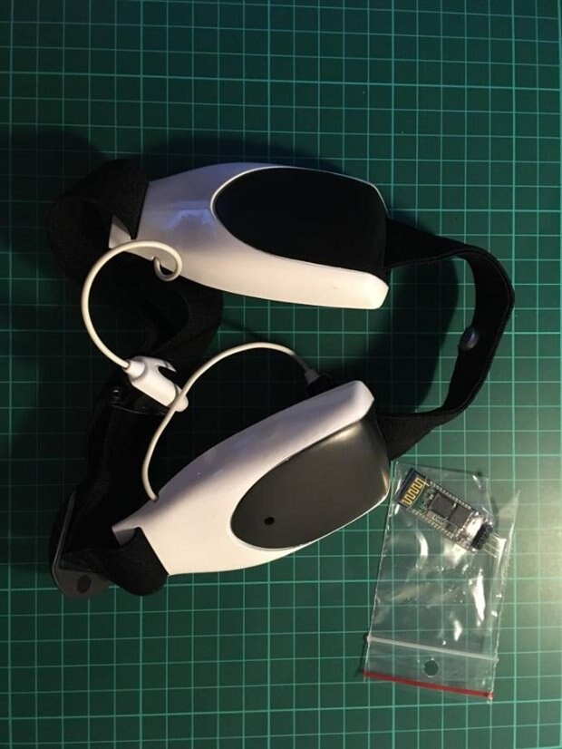
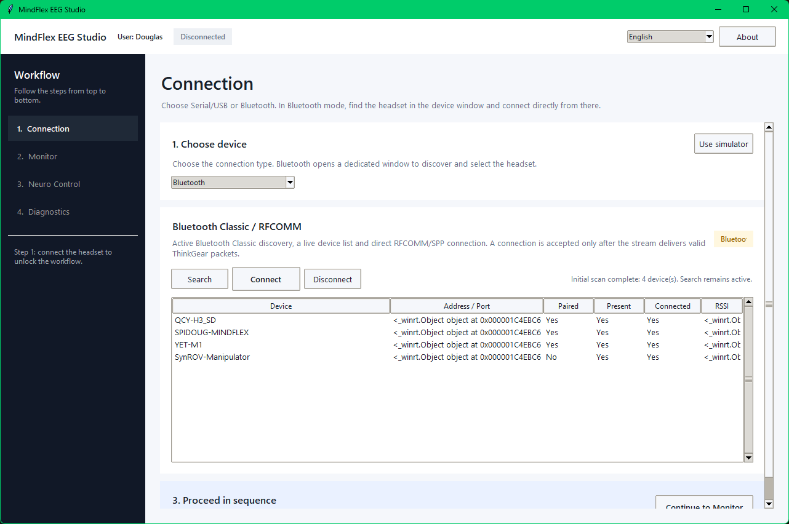
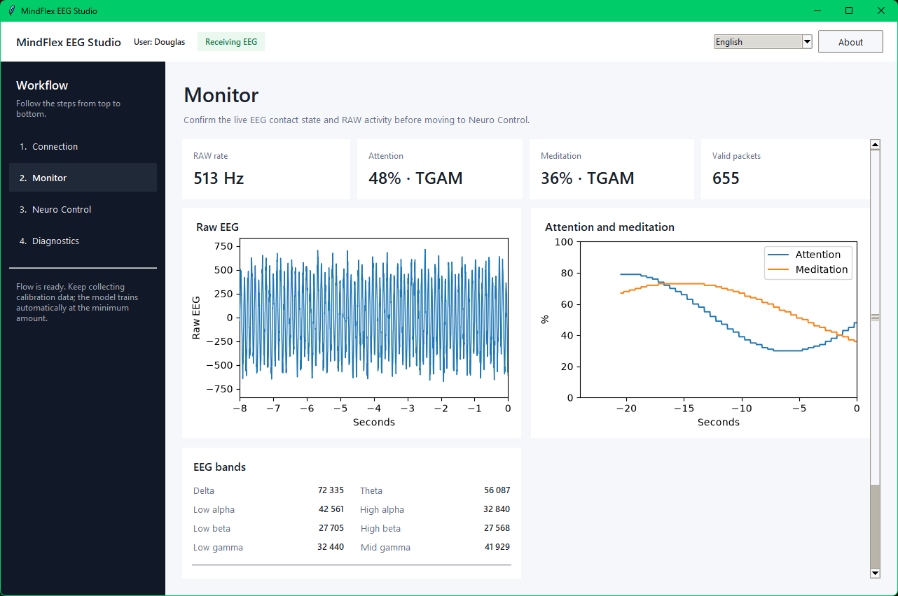
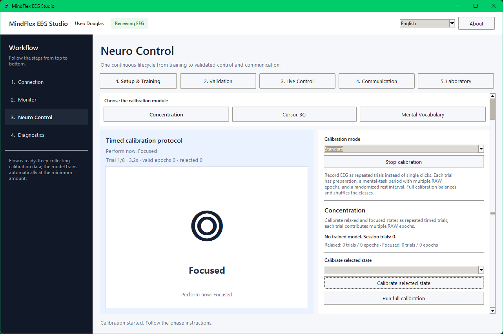
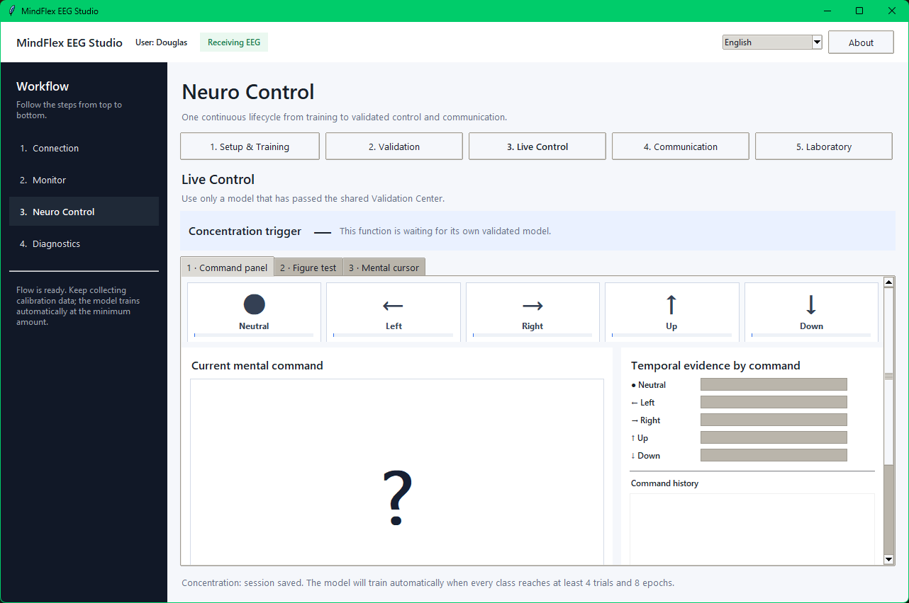
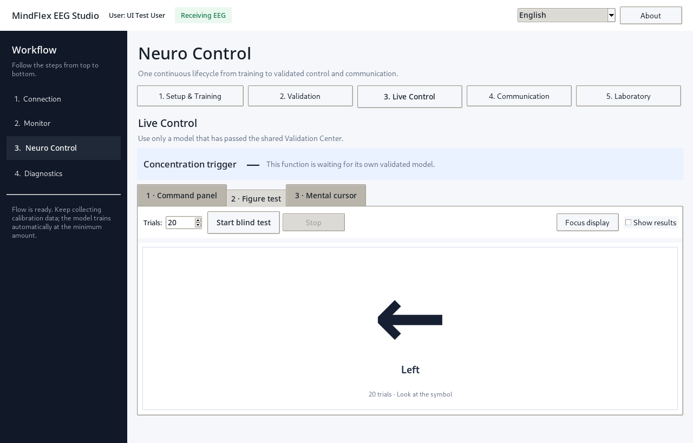
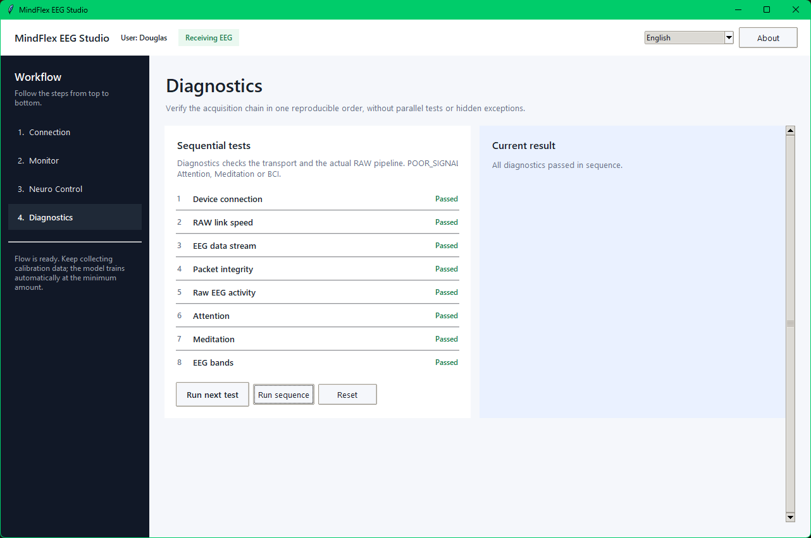

# MindFlex EEG Studio

MindFlex EEG Studio is an experimental desktop application for MindFlex / TGAM1 EEG acquisition, signal monitoring, diagnostics, calibration and brain–computer interface (BCI) experiments. It includes an offline simulator and reproducible engineering benchmarks.

**Release:** `1.0.0` · **Python:** 3.10+ · **Interface:** Tkinter



## Screenshots

| Connection | EEG monitor |
| --- | --- |
|  |  |

| BCI training | Live BCI controls |
| --- | --- |
|  |  |





## Features

- ThinkGear packet parsing and signed RAW EEG capture at **512 samples/s** over a **57,600-baud** serial stream.
- Live RAW, contact-quality, band-power, Attention and Meditation monitoring and diagnostics.
- BCI processing driven exclusively by RAW EEG: **1.5 s windows**, artifact gating, Welch spectral features and **shrinkage-LDA** classification.
- **24 features**, a **0.25 s decision stride**, and a **three-decision stabilizer** used consistently across training, validation and live control.
- Session recording, replay and independent-trial model evaluation, including continuity markers for corrupted or interrupted streams.
- Built-in simulator, offline benchmark and automated regression tests.
- English, Portuguese (Brazil), Spanish, French, German, Italian and Japanese interface catalogs.

Attention and Meditation are **diagnostic metrics only**; they are not fed to the BCI classifier.

## Installation

Clone or extract the repository and open a terminal in its root directory. A virtual environment is recommended:

```bash
python -m venv .venv
```

Activate it on Windows with `.venv\Scripts\activate` or on Linux with `source .venv/bin/activate`, then install:

```bash
python -m pip install -e .
```

On Ubuntu/Debian, the system-provided `python3-tk` and `python3-venv` packages may be needed. The application requires a graphical display and Matplotlib; the headless benchmarks do not.

To start the application:

```bash
python -m mindflex
```

**Windows quick start:** double-click `RUN_STUDIO.bat`. It selects a compatible Python (3.12 recommended; 3.11/3.13 supported), creates `.venv` if necessary, installs missing dependencies, then launches the UI. The initial setup needs internet access and write permission in the extracted project folder. On a startup failure the console **stays open**, and a log is saved in `logs/studio-startup.log` (or a temporary fallback directory if the checkout is read-only). Run `RUN_STUDIO.bat --diagnose` for explicit environment and Tk checks. See [Windows startup and troubleshooting](docs/STARTUP.md).

**Linux quick start:** run `chmod +x RUN_STUDIO.sh && ./RUN_STUDIO.sh`. Like Windows, it creates/reuses `.venv`, installs missing pip dependencies, captures startup errors and supports `./RUN_STUDIO.sh --diagnose`. If Tkinter is missing, it offers an explicitly approved system-package installation when launched from an interactive terminal (Ubuntu/Debian: `sudo apt-get install python3-tk`); sudo is never run silently. See [Linux startup and troubleshooting](docs/STARTUP.md).

Python 3.14+ is not selected by the Windows launcher because of the currently pinned WinRT 3.x Bluetooth dependencies.

### Device connection

1. For a physical TGAM1, configure **BR1=VCC, BR0=GND** for RAW at 57,600 baud. Confirm voltage and pad orientation before making hardware changes; see [Hardware setup](docs/HARDWARE_SETUP.md).
2. On Windows, use the Bluetooth Classic RFCOMM/SPP discovery backend or select an explicit Serial/USB endpoint. Bluetooth availability depends on the adapter, driver and device pairing.
3. On Linux, use the **Bluetooth** tab for native BlueZ Bluetooth Classic discovery and RFCOMM/SPP streaming. Install `bluez`, enable the Bluetooth service, and pair the MindFlex in system Bluetooth Settings if pairing requires a PIN. No WinRT is installed or imported on Linux. Serial/USB and the Simulator also remain available. See [Linux Bluetooth](docs/LINUX_BLUETOOTH.md).
4. Without hardware, use the **Simulator** action on the Connection page. Simulation does not demonstrate human BCI accuracy.

## Signal pipeline

```text
ThinkGear transport → integrity-aware RAW buffer (512 Hz)
 → fixed 768-sample epoch (1.5 s, 128-sample hop)
 → Hampel + artifact checks + 0.5–45 Hz filtering
 → Welch PSD → 24-dimensional features
 → class-balanced shrinkage LDA
 → 3 consecutive decisions → gated output
```

A single controller owns the sample counter and stream integrity state. Cue-based acquisition starts only after the cue is rendered. Validation is scored by independent trial and includes abstentions. Training and live controls share the same feature extractor and decision rules. See [Architecture](docs/ARCHITECTURE.md) for the complete design and storage schema.

## Testing and benchmarking

The following commands work without physical hardware:

```bash
python -m unittest discover -s tests -v
python -m mindflex.benchmark --output benchmark-results.json
```

The Tkinter GUI smoke test is opt-in; on Linux use a virtual display:

```bash
MIND_FLEX_RUN_GUI_TESTS=1 xvfb-run -a python -m unittest discover -s tests -v
```

Test data include synthetic EEG, artifacts, reconnection/corruption, recording/replay and simulated model calibration. Benchmark results are generated locally and ignored by Git. Read [Testing and validation](docs/TESTING.md) for coverage, interpretation, and remaining hardware/real-user validation requirements.

## Visual test workspace

In **Neuro Control → Live control → Figure test**, the cue is the primary surface.
The results panel is hidden by default; use **Show results** to inspect accuracy,
confidence and the confusion matrix. **Focus display** opens a large, distraction-free
cue presentation that follows the same test session; press **Escape** or **Close**
to return. The layout adapts to narrower windows, and all seven languages retain
their translated controls. The display mode does not change the EEG pipeline,
classification or test timing.

## User data and privacy

Application settings, local profiles, calibration models, and `.mfs` RAW recordings are saved in `sessions/` beside the checkout when running from source. This directory is Git-ignored. **EEG recordings can be sensitive:** inspect your working tree and avoid committing or sharing sessions from real people without appropriate permission.

Stored model and recording formats are version-checked; foreign/older data are not automatically migrated. Recalibrate and independently validate any model created with different preprocessing.

## Scope and safety

This software is for education, research and experimentation. It is **not a medical device** and must not be used for diagnosis, treatment or safety-critical control. A single EEG channel cannot guarantee rejection of movement, muscle and ocular artifacts. Synthetic benchmarks validate software behavior under modeled conditions, **not reliable thought decoding in human participants**.

## Documentation

- [Architecture](docs/ARCHITECTURE.md): modules, BCI timing, model and persistence contract.
- [Hardware setup](docs/HARDWARE_SETUP.md): TGAM wiring, pad settings, voltages and photos.
- [Testing and validation](docs/TESTING.md): reproducible checks, scenario coverage and limitations.
- [Contributing](CONTRIBUTING.md): coding and test expectations for pull requests.
- [Startup and diagnostics](docs/STARTUP.md): Windows and Linux launchers, Python selection, system packages and logs.
- [Linux Bluetooth](docs/LINUX_BLUETOOTH.md): BlueZ discovery, RFCOMM pairing, channel probing and troubleshooting.

**License:** MIT, © 2026 Douglas Santana. See [LICENSE](LICENSE). Before publishing,
confirm that photographs and any other third-party assets included in the repository
can be redistributed under the stated terms.
